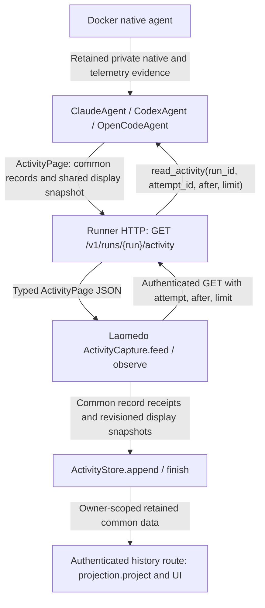

# Activity interface

The selected boundary is implemented on the existing Python `BaseAgent` ABC.
**Activity implementation, selected specification and this document reviewed.**
Claude approved the code delta `ebf74f27..3778e2714` and the selected Activity
specification section, then read this complete document and approved it subject
to this review-status correction. Later edits here only record that verdict.
Real Codex fresh/resume/cancellation passed; Claude fresh/resume/confirmed
cancellation and explicitly composed OpenCode fresh/resume/active-worker
cancellation also passed through HTTP capture/store/common display and replay.
Claude approved the experiment harnesses and supported the disclosed conclusions
at exp `c11976467..271f9058c`. See [Claude evidence and teardown limitation](https://github.com/amadou-6e/laomedo/blob/271f9058c/experiments/docker-boundary-277/evidence/2026-11-11-claude-activity.md)
and [OpenCode evidence and supported-route scope](https://github.com/amadou-6e/laomedo/blob/271f9058c/experiments/docker-boundary-277/evidence/2026-11-11-opencode-activity.md).
Failed observations remain preserved. Claude's initial process exited with a
Windows log-cleanup error after successful model flows and auth-volume removal;
the corrected harness teardown was not rerun live. OpenCode default host
composition, unsupported routes, authenticated readiness and host-loss/daemon-wide
cleanup remain unaccepted. The unused runtime-role guard failure was resolved;
all five GitHub checks pass at `68415e3dd`. PR #250 remains draft with older
whole-PR review gaps; scoped approvals do not approve the whole PR.

## Public method and caller

```python
class BaseAgent(ABC):
    @abstractmethod
    def read_activity(
        self,
        run_id: str,
        attempt_id: str,
        *,
        after: int = 0,
        limit: int = 100,
    ) -> ActivityPage:
        """Read normalized activity for one explicit execution attempt."""
```

`ClaudeAgent`, `CodexAgent` and `OpenCodeAgent` implement this method. The caller
supplies an admitted run UUID and the explicit attempt UUID returned by execution;
resume has a different attempt even when the native conversation is unchanged.
There is no public Activity reader, projector service or observation lifecycle.

```python
page = agent.read_activity(run_id, attempt_id, after=0, limit=100)
for record in page.records:
    display(record.event)
# Poll later when open; read immediately while has_more is true.
page = agent.read_activity(run_id, attempt_id, after=page.next_after)
```

`display` represents application code. Reading never starts a model, checks login,
launches Docker, cancels work or closes resources. It can publish new normalized
versions into the provider's private durable journal. The journal must be retained
with the run: deleting it invalidates previously issued cursor meanings.

## Exact data contract

The canonical executable declarations are in
[`models.py`](../../src/laomedo/agents/activity/models.py). All new models forbid
extra fields, validate types and hide inputs in validation errors. These are
shared Pydantic data values, not additional services.

| Value | Fields | Meaning |
| --- | --- | --- |
| `MessageActivity` | `kind="message"`, `message_id`, `thread_id`, `role` (`user`/`assistant`), `text`, `removed=False` | Full current text, including incremental updates; keyed by thread and message ID. |
| `ToolCallActivity` | `kind="tool_call"`, `tool_call_id`, `thread_id`, `name`, JSON `arguments`, `removed=False` | Current call description; keyed by thread and call ID. |
| `ToolResultActivity` | `kind="tool_result"`, `tool_call_id`, `thread_id`, `status`, nullable `output`, `removed=False` | Full current output; status is running/completed/failed/cancelled/unknown. Streamed output replaces the earlier snapshot. |
| `UsageActivity` | `kind="usage"`, `thread_id`, six nullable counters, `removed=False` | Attempt-to-date usage for that thread, after provider baseline accounting. |
| `ActivityRecord` | positive `sequence`, nullable `occurred_at`, `observed_at`, discriminated `event` union above | One immutable observed version. Unknown provider occurrence time stays null. |

Reasoning items remain available in the rich display snapshot but are not
misrepresented as assistant-answer MessageActivity records. Native non-message
operations (file changes, searches, plans and collaboration included) currently
use generic tool-call/result records with their native type as name; consumers
must not assume these all represent a provider function-call protocol.
All shared snapshots use the common `to_payload()` JSON key order, including
OpenCode; JSON field values and diagnostics omission are preserved. Key ordering
is not a semantic distinction between providers.

Usage counters are `input_tokens`, `output_tokens`, `cached_input_tokens`,
`reasoning_output_tokens`, `cache_write_input_tokens`, `total_tokens`. Known
values are nonnegative integers; null means unknown. **Replace usage by thread;
do not sum successive usage records or overlapping token categories.** Existing
provider accounting retains child-thread and resumed-attempt attribution.

`ActivityPage` contains these exact fields:

| Field | Type | Guarantee |
| --- | --- | --- |
| `run_id`, `attempt_id` | str | Exact requested identities. |
| `available` | bool | This attempt's source boundary exists. |
| `records` | list[ActivityRecord] | Strictly increasing sequences greater than requested after. |
| `next_after` | int | Last returned sequence, or unchanged requested after for an empty page. |
| `has_more` | bool | More published records exist; true requires a nonempty page. |
| `closed` | bool | Both native and telemetry source end positions are sealed. |
| `complete` | bool or None | Null while open/unavailable; final evidence completeness once closed. |
| `reason` | str or None | Stable unavailability or incomplete-capture category; required when incomplete. |
| `projection` | ActivityProjection or None | Already assembled shared display snapshot, preserving thread topology, telemetry, diagnostics, pricing and rich items. |
| `projection_revision` | int, default 0 | Positive, monotonic revision when a projection is supplied. Can advance without a new common event. |
| `status`, `thread_id`, `model`, `ended_at` | str or None, default None | Observed execution outcome and bindings, distinct from completeness. |

The projection/revision and outcome fields extend the conversational sketch
explicitly. Four message/tool/usage variants alone do not represent the existing
rich display envelope. Returning that shared data preserves display without
adding a second provider interface or parsing native evidence in the application.

## Streaming, replay and closure

The internal `ActivityNormalizer` reads the provider's retained native/telemetry
intervals, invokes that provider's existing interpretation functions, and commits
changed common snapshots to `activity-normalized.db` in the run directory.
SQLite serializes readers' publication transactions. Each attempt has its own
append-only sequence; independent native/OTLP physical positions are never merged
into that public cursor. Source starts and sealed ends cannot change after being
published. A concurrent seal triggers a bounded re-read of both source intervals.

A changed message/tool snapshot appends a new record with the same identity.
Consumers replace the earlier value, rather than concatenating full snapshots.
`removed=True` retracts a previously published identity. Disappearing known usage
becomes an unknown-counter replacement. Prior records never change. A restarted
reader reuses the durable journal; retries do not consume evidence. Late evidence
or metadata can append versions and revise the display snapshot even after a
prior read. Capture stops following only after the sealed sources are drained.

| Situation | Result |
| --- | --- |
| First read | after=0; limit defaults to 100. |
| Missing attempt on a known run | available=False, no records, unchanged cursor, open, complete=None, activity_attempt_not_available. |
| No records yet, open capture | has_more=False; poll later. |
| More records retained | has_more=True; continue immediately with next_after. |
| Closed, unread records | closed=True can coexist with has_more=True; drain all pages. |
| Closed with complete evidence | complete=True; does not imply successful execution or cleanup. |
| Closed, missing/truncated evidence or capture error | complete=False with reason; never upgraded from task success. |
| Observer stops | Does not cancel execution or clean resources. |

Claude/Codex require a retained terminal native event and no capture error;
OpenCode requires explicit native snapshot `capture_complete=True` and no capture
error. Both source intervals must be sealed for closed=True. Reads that cannot
reach sealed end positions are incomplete. Application capture consumes these
facts without branching on provider names.

## Transport, persistence and display



`ActivityCapture` validates JSON and exact run/attempt identities, claims the
attempt once, stores the display revision first, then common records. Store
receipt deduplication uses sources containing run/attempt and record sequence.
The store atomically replaces its single display snapshot for the invocation
when a higher projection revision arrives; stale/repeated revisions cannot replace
it. This mutable display slot is separate from immutable normalized records and
the provider's public cursor. The authenticated detail route uses this latest
snapshot directly and omits duplicate snapshot/common record bodies from its
`events`; the bounded raw-receipt endpoint remains available. The latest view does
not depend on traversing the 20,000-receipt historical detail limit.
Invocation ownership, flow/node scope and the receipt schema remain; a small
snapshot revision index identifies the mutable display slot. Detail clears usage
and cost totals for `activity_projection_limit` or `invocation_boundary_unverified`.
The store is Laomedo persistence, not a provider capability; historical display needs no live Agent, Docker or authentication
check against the provider.

Application `projection.project` selects the highest retained common display
revision. New normalized ingestion never calls a provider parser. Existing saved
Activity databases containing native receipts retain a **read-only historical
path** in `activity/legacy.py`; that path uses native helpers for those old rows
only. This is not personal graph migration or a requirement for new providers.
The private raw `/events` transport remains for evidence readers; new Activity
capture uses `/activity`.

## Validation, limits and failures

Cursor and limit must be exact integers: after>=0, limit 1..200. Future cursors
are refused, not silently reset. Invalid UUIDs, unknown runs, mismatched source
boundaries and journal failures raise the existing `RunnerError` with stable
categories. No new Activity exception hierarchy is introduced.

Each source interpretation is bounded to 20,000 receipts/20MiB. Individual source
lines and common records are bounded to 2 MiB; the shared display snapshot to 20 MiB.
The durable journal has a 128 MiB logical data budget **per attempt**, including
record bodies, current normalized state and the current display snapshot; SQLite
page overhead and independent resumed attempts are not a run-wide failure gate.
At a source bound, the retained prefix remains readable; at a publication budget,
previously published versions remain readable. A page reports
`reason="activity_projection_limit"`; it remains open with complete=None until
both source ends are sealed, then becomes closed with complete=False. It never
claims source closure merely because a budget was reached. Later resumed attempts
have independent budgets. Partial totals are not complete accounting evidence. Error categories include
invalid_activity_cursor, invalid_activity_attempt_id, activity_run_not_found,
activity_attempt_identity_mismatch, activity_normalization_failed,
activity_projection_limit and activity_journal_unavailable. A corrupt journal is
not deleted/replayed automatically because that could change cursor meanings.

## Removed and retained objects

| Object | Implementation disposition |
| --- | --- |
| ActivityStore | Kept: owner-scoped retention, deduplication and invocation metadata. |
| ActivityProjection | Kept: shared rich display data returned by the provider read boundary. |
| BaseActivityProjector and three activity/projector.py forwarding classes | Removed; read_activity is the public provider obligation. |
| Provider native interpretation and usage helpers | Kept internally to preserve full-history/baseline accounting. |
| Registry activity_projector/projector_for_events methods | Removed; no application dispatch for new normalized history. |
| ActivityCapture | Kept; follows typed common pages instead of private raw streams. |
| Native/telemetry evidence | Kept; no retention policy change. |
| RunnerActivityReader, ActivityReader, ActivityStore.read_detail, ActivityReadRequest | Withdrawn design names; not introduced. |

## Acceptance scope

Retained-evidence tests exercise stable replay, concurrent readers, resumed
intervals, incremental tool output, replacement usage, completeness, invalid
cursors, and real HTTP capture/store/display with owner isolation. Synthetic
source fixtures are not real agent execution acceptance. Real native execution
and reviewer coverage must be reported separately in the PR; this document does
not establish them. The remaining broad-PR review and recovery-acceptance gaps remain separately scoped.
