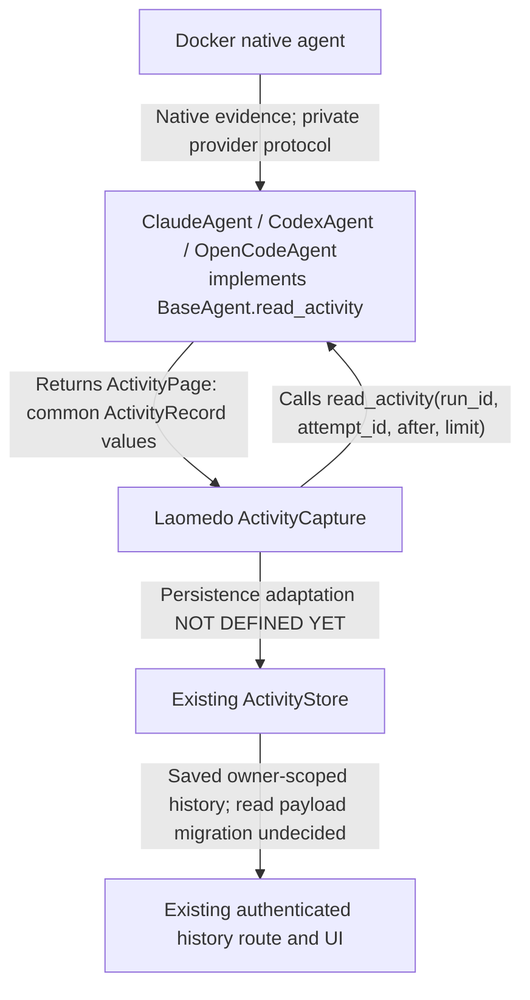

# Activity interface ? discussion draft 1

This file is the single reference for our discussion. It records the last
explicit read_activity proposal from the conversation; it does not silently
choose between that proposal and the older read-time projector design.

**Status: proposed, not implemented, fully unreviewed ? reviewer pending.**
Claude's earlier recommendation to retain the existing projector does not approve
this alternative. No production Activity classes or storage schemas have changed.
We will change this file explicitly when a decision changes, keeping the method,
models, call example and diagram consistent in the same edit.

## The proposed boundary

Laomedo calls a method declared on the existing Python abstract class BaseAgent.
The selected provider implements that method. The returned records are intended
to be Laomedo-format data, not raw provider events requiring another public
projector call. The provider can keep existing parsers/projectors internally.

The code below is an interface sketch, not executable production implementation.
It adds one proposed operation to the existing BaseAgent, not another Agent class.
The other classes are proposed data values, not extra services or collaborators.

```python
from abc import ABC, abstractmethod
from datetime import datetime
from typing import Annotated, Literal

from pydantic import BaseModel, Field


class MessageActivity(BaseModel):
    kind: Literal["message"] = "message"
    message_id: str
    thread_id: str
    role: Literal["user", "assistant"]
    text: str


class ToolCallActivity(BaseModel):
    kind: Literal["tool_call"] = "tool_call"
    tool_call_id: str
    thread_id: str
    name: str
    arguments: dict


class ToolResultActivity(BaseModel):
    kind: Literal["tool_result"] = "tool_result"
    tool_call_id: str
    status: Literal["completed", "failed", "cancelled", "unknown"]
    output: str | None


class UsageActivity(BaseModel):
    kind: Literal["usage"] = "usage"
    thread_id: str
    input_tokens: int | None
    output_tokens: int | None
    cached_input_tokens: int | None
    reasoning_output_tokens: int | None


class ActivityRecord(BaseModel):
    sequence: int
    occurred_at: datetime | None
    observed_at: datetime
    event: Annotated[
        MessageActivity | ToolCallActivity | ToolResultActivity | UsageActivity,
        Field(discriminator="kind"),
    ]


class ActivityPage(BaseModel):
    run_id: str
    attempt_id: str
    available: bool
    records: list[ActivityRecord]
    next_after: int
    has_more: bool
    closed: bool
    complete: bool | None
    reason: str | None


class BaseAgent(ABC):
    @abstractmethod
    def read_activity(
        self,
        run_id: str,
        attempt_id: str,
        *,
        after: int = 0,
        limit: int = 100,
    ) -> ActivityPage:
        """Read Laomedo-format activity for one explicit execution attempt."""
```

These data definitions preserve the latest conversational sketch; they are not
being presented as a completed common schema. For example, cache-write tokens,
parent/child threads and streamed tool output are not represented yet. The open
decisions below must be resolved before turning this code into production models.

## Caller and callee

| Caller | Callee | Operation crossing the proposed boundary |
| --- | --- | --- |
| Shared Laomedo ActivityCapture | ClaudeAgent / CodexAgent / OpenCodeAgent, through BaseAgent | read_activity(run_id, attempt_id, after=..., limit=...) |
| Same provider Agent | Same calling ActivityCapture | Returns ActivityPage containing ActivityRecord values. |

The provider's native Docker protocol stays internal. Converting it into common
records is the provider's responsibility under this proposal. The physical
native/OTLP file cursors are also internal; after is a proposed stable common
record sequence, not either physical cursor or the SQL receipt sequence.

That common sequence does not currently exist merely because this declaration
names it. Its production, replay stability and interaction with late evidence
must be designed and verified; see the open decisions.

## Exact example of the proposed call

```python
page = agent.read_activity(
    run_id,
    attempt_id,
    after=0,
    limit=100,
)

if page.available:
    for record in page.records:
        display(record.event)

    next_page = agent.read_activity(
        run_id,
        attempt_id,
        after=page.next_after,
        limit=100,
    )
```

display is application code in this example, not another proposed interface.
This shows only the provider read boundary. It does not pretend the existing
ActivityStore.append already accepts the proposed ActivityRecord format.

## Paging and lifecycle guarantees proposed so far

| Situation | Proposed result or behavior |
| --- | --- |
| First read | after=0. |
| Later read | Use next_after from the previous page for the same run and attempt. |
| Ordering | Returned sequence values are strictly increasing and greater than after. |
| Retry | Reading does not consume evidence or execute a model; sequence attribution stays stable. |
| More retained records available | has_more=True; read again immediately. |
| No more records yet, capture open | has_more=False, closed=False; poll later. |
| Attempt not available yet | available=False, records=[], next_after=after, has_more=False, closed=False, complete=None, reason explains why. |
| Capture closed and fully recorded | closed=True, complete=True. This is not task success or resource cleanup. |
| Capture closed with missing evidence | closed=True, complete=False, reason names the stable category. |
| Capture open | complete=None; final completeness is not yet known. |
| Closed capture with unread records | closed=True, has_more=True; continue reading until drained. |
| Resume | Use its explicit new attempt_id; do not switch to the latest attempt automatically. |
| Observation stops | No cancellation, native process closure or execution side effect. |

The latest sketch named ActivityReadError without defining it. This draft does
not introduce that exception as an approved object. Exact existing exception
reuse, stable error categories and HTTP mapping are still an open decision.

## Data flow with the actual proposed method visible



The arrows returning pages and requesting reads are deliberately separate. No
unlabelled reader or projector service is hidden between them. Internal native
capture/files may remain; the sketch does not imply their removal.

## Why storage still exists

The proposed method is the source of provider activity. ActivityStore is the
application's retained owner/flow/node-scoped copy, so historical display need
not construct or contact a live Agent. It also owns ingestion deduplication and
invocation metadata. These are not the same job.

However, today's store holds native receipt wrappers, not the proposed common
records. Connecting this API to persistence requires an explicit adapter or
storage-format migration. We have not selected one. No read_detail method or
new reader class is proposed to disguise that missing decision.

## What this changes from the existing implementation

Today the existing provider BaseActivityProjector translates accumulated stored
native receipts at application read time. This draft instead proposes returning
common records from BaseAgent.read_activity. Existing projector functions may
remain internal implementation helpers, but they cannot simply be renamed into
a per-page converter: some interpretation requires complete history/baselines
and post-shutdown metadata.

These are two different designs. Claude previously recommended the existing
read-time approach as the smallest change. This alternative has not been
reviewed or selected as a final replacement. A later decision to reject it must
be written here explicitly rather than silently switching the explanation back.

## Decisions that are genuinely still missing

1. **Common sequence production:** persisted normalized log versus stable replay
   of native evidence; how late snapshots and metadata can revise earlier facts
   without changing old cursor meanings. Do not merge physical source cursors.
2. **Complete record schema:** thread parentage, message edits/deltas, partial
   tool output, attachments, diagnostics, cache-write/total counters, units,
   missing versus partial evidence, costs and source provenance.
3. **Update semantics:** the earlier sketch proposed replacing a displayed
   message by message_id. Revision ordering, deletion and duplicate handling
   still need a precise definition; sequence alone is not a message revision.
4. **Usage accounting:** attempt-only usage versus cumulative snapshots, multiple
   usage records, inclusive child totals, baseline subtraction and unknown
   counters. No per-record summation rule has been defined.
5. **Capture closure:** which component publishes closed/complete and reason,
   when both native and telemetry sources are sealed, and how observer failure
   differs from execution failure or resource cleanup uncertainty.
6. **Invocation binding and persistence:** how existing invocation_id/owner/flow/
   node relates to run_id/attempt_id and each normalized record; ingestion API,
   deduplication key, stored format and existing HTTP compatibility.
7. **Errors and validation:** unknown run versus not-yet-created attempt,
   malformed IDs, invalid/future cursors, limit and byte bounds, unreadable or
   corrupt evidence, unknown record kinds and model versioning.
8. **Provider feasibility:** prove the same guarantees for Claude, Codex and
   OpenCode while preserving their differing native history and finalization.
9. **Read-only history:** confirm that application reads of retained data do not
   instantiate a live provider or invoke Docker/auth checks. Specify any helper
   needed by the provider implementation without making it a public collaborator.

Do not implement before these decisions are resolved and reviewed. This file
fixes the names and visible boundary so discussion can refer to exact sections;
it does not claim unfinished semantics are a complete interface.
