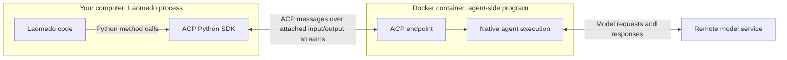
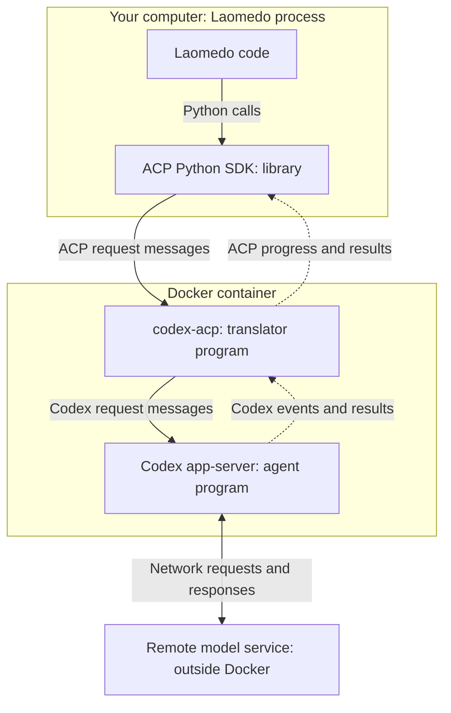
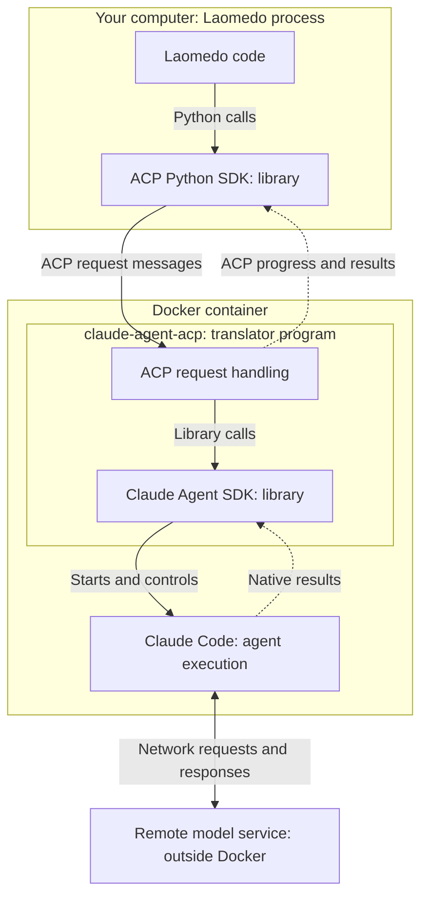
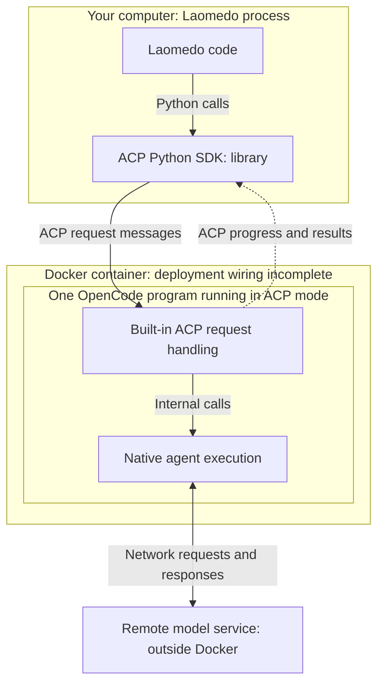

# How Laomedo talks to an agent

This guide starts without assuming knowledge of SDKs, ACP, servers or Docker.
It explains the dependency stack inspected on `refactor/205` at `c06cc017`.
It is a source-architecture explanation, not proof that every provider path works.

## Start with the task, not the dependencies

You enter a task in Laomedo. Another program, such as Codex, Claude Code or
OpenCode, performs the agent work. Laomedo needs to tell that program to start,
send it your task, receive progress, ask it to stop and later resume a conversation.

The agent program runs a loop: ask a model what to do, execute permitted tools,
return their results to the model, and continue until it finishes or stops.
The model service and the local agent program are different things. The local
program manages tools and sessions; the remote model produces responses.

Laomedo does not implement each vendor's agent loop. It controls those existing
programs and records their outcomes.

## Six words used throughout the diagrams

| Word | Plain meaning | Example here |
| --- | --- | --- |
| Process | A running program with its own lifetime | A running `codex app-server` |
| Interface | The operations one component lets another use | Start a conversation, submit a task, cancel |
| Protocol | Agreed message names, formats and interaction rules | ACP defines messages for conversations and progress |
| SDK | A software development kit: reusable code programmers call | The ACP Python SDK sends and receives ACP messages for Laomedo |
| Server | A program that accepts requests from another program | Codex app-server accepts requests to control Codex |
| Adapter | Code that translates between two interfaces | codex-acp translates ACP requests into Codex requests |

An SDK is code used by a program. A server is a running program being contacted.
They can work together: an SDK can send requests to a server. They are not two
competing kinds of agent.

A server does not necessarily mean a website, a remote machine or a cloud service.
Here, requests can travel over the local program's standard input and output:
streams through which programs read and write text. No browser is involved.

## What ACP is, and where it is

**ACP means Agent Client Protocol.** See the [upstream protocol overview](https://github.com/agentclientprotocol/agent-client-protocol/blob/main/docs/protocol/v1/overview.mdx)
and [ACP Python SDK](https://github.com/agentclientprotocol/python-sdk). It specifies how an application talks to an
agent: initialize the connection, create or load a conversation, submit a task,
receive updates and request cancellation. Its messages use JSON-RPC, a structured
format for naming an operation and carrying its arguments or result.

ACP is the agreement about the messages. It is not a process or a container.
An ACP SDK implements the message handling. An ACP endpoint is the part of a
running program that receives those messages.

In our stack, there are two ends:

- **Client end, on the host:** Laomedo calls the ACP Python SDK.
- **Agent end, inside Docker:** an adapter or OpenCode itself receives ACP messages.

Docker supplies the environment in which the agent-side program runs. Docker
is not ACP and does not understand prompts. Our Docker transport moves the bytes
between these ends; the ACP SDK understands their message structure.

In the diagrams, solid arrows show requests or calls; dotted arrows show returning
progress or results. Labelled boxes distinguish libraries from running programs.
The model service is remote, outside both the host process and the container.

## Why there is another layer after ACP

Not every agent originally exposes ACP. If an agent exposes another interface,
a translator must stand between that interface and Laomedo's ACP connection.
That translator is an ACP adapter.

### Codex: an adapter controls a local server

Upstream: [codex-acp adapter](https://github.com/agentclientprotocol/codex-acp)
and [Codex app-server documentation](https://developers.openai.com/codex/app-server/).

`codex app-server` is Codex running in a mode intended for another application
to control it. It manages Codex conversations and execution and exposes its own
request/event interface. It is not the OpenAI model server and not Laomedo's
local backend HTTP server.

`codex-acp` is a separate upstream project translating between ACP and that
Codex interface. Our build modifies this adapter to preserve native events and
apply specific launch/policy and output-precheck hooks. Those additions are our
code; the adapter and Codex engine are upstream code.

An event is a message about something that happened, such as progress or completion.
It is data emitted by a component, not a substitute name for that component.

### Claude: an adapter calls a programming library

Upstream: [claude-agent-acp adapter](https://github.com/agentclientprotocol/claude-agent-acp)
and [Claude Agent SDK documentation](https://code.claude.com/docs/en/agent-sdk/overview).

The Claude Agent SDK is Anthropic's programming interface for running its agent
capabilities. The upstream `claude-agent-acp` adapter uses that SDK and exposes
ACP to us. Laomedo Python does not directly import this TypeScript SDK.

Our container installs the ACP adapter, its Agent SDK dependency and Claude Code.
The runtime configuration selects the installed Claude executable. The SDK is
shown as a library boundary; it should not be drawn as an independent server
merely because it appears in a separate box.

Our command bridge handles permitted tool execution through the host. It is an
additional tool interface, not the code translating all Claude requests into ACP.

### OpenCode: the program already understands ACP

Upstream: [OpenCode ACP documentation](https://opencode.ai/docs/acp/).

OpenCode includes an ACP interface. The endpoint and the agent execution belong
to the same program. There is no separate ACP translator package in this path.
That explains why it does not need the same custom adapter files as Codex.
Our maintained Docker deployment wiring remains incomplete; this diagram describes
the intended native connection used by the existing integration, not a working
fresh-install claim.

## What is common and what really differs

| Question | Codex | Claude | OpenCode |
| --- | --- | --- | --- |
| What does Laomedo speak? | ACP | ACP | ACP |
| What receives ACP? | codex-acp adapter | claude-agent-acp adapter | OpenCode itself |
| What does that receiver call next? | Codex app-server interface | Claude Agent SDK | Its own internal execution |
| Is a separate translation package used? | Yes | Yes | No |
| Where do our special integration hooks sit? | Patched adapter and host provider code | Host provider code and tool bridge | Host provider code and native configuration/history handling |

These are different integration surfaces underneath one common application
connection. That difference explains some provider-specific code. It does not
justify duplicating generic Docker lifecycle or common request handling.

## Follow one task through the layers

1. You submit a task in the graph.
2. Laomedo admits the run and prepares its configuration and working files.
3. Laomedo starts the selected agent-side program in Docker.
4. The ACP Python SDK opens or loads a conversation and sends the task.
5. The receiver translates ACP when needed: Codex adapter, Claude adapter, or
   OpenCode's native implementation.
6. The native agent requests model responses and executes permitted tools.
7. Progress travels back through the ACP connection. Provider-specific evidence
   can also use additional channels; ACP is not a guarantee of every native event.
8. Laomedo retains the result and evidence and records cleanup outcomes.

Tool requests are a separate direction of interaction: the agent asks to use a
tool. MCP (Model Context Protocol) is another message standard used for that
purpose in parts of this implementation. ACP controls the agent conversation;
MCP exposes tools to the agent. Docker manages the programs that implement them.

## Where our architectural choices begin

Choosing ACP lets our application use one conversation interface across providers.
The upstream adapters absorb differences between the vendors' native interfaces.
We still own application authorization, run records, Docker configuration, safe
credential provisioning, tool policy and evidence interpretation.

ACP does not make every provider's capabilities, event detail, authentication,
isolation or persistence identical. When our requirements exceed the common
messages, we need a narrow extension or another evidence channel. Each such
addition should name the missing capability and its upstream interface.

The next comparison diagrams should distinguish running programs, libraries and
message formats explicitly. A box labelled 'events' cannot explain where custom
code runs; the emitting program and receiving adapter must be visible.

## Sources and implementation anchors

Upstream sources explain their concepts; checked-in manifests establish the
versions and wiring described here.

- [ACP protocol overview](https://github.com/agentclientprotocol/agent-client-protocol/blob/main/docs/protocol/v1/overview.mdx).
- [Codex integration options](https://developers.openai.com/blog/codex-as-a-platform).
- [Claude SDK and CLI overview](https://platform.claude.com/docs/en/cli-sdks-libraries/overview).
- [Shared ACP client](../../../src/laomedo/agents/agents/base/acp/session.py).
- [Codex image and adapter build](../../../docker/codex-acp/Dockerfile).
- [Claude image](../../../docker/claude/Dockerfile) and [locked adapter/SDK dependencies](../../../docker/claude/package-lock.json).
- [OpenCode integration](../../../src/laomedo/agents/agents/opencode/boundary.py).
- [Detailed provider diagrams](assets/provider-interactions/README.md).

This is the first explanatory revision for discussion. Understanding and agreement
on the explanation remain open; no runtime change or merge is implied.
