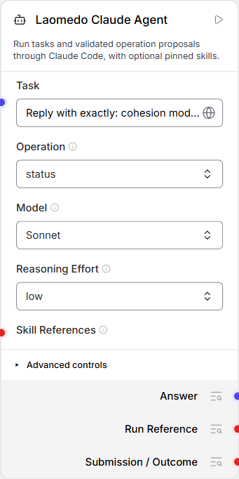
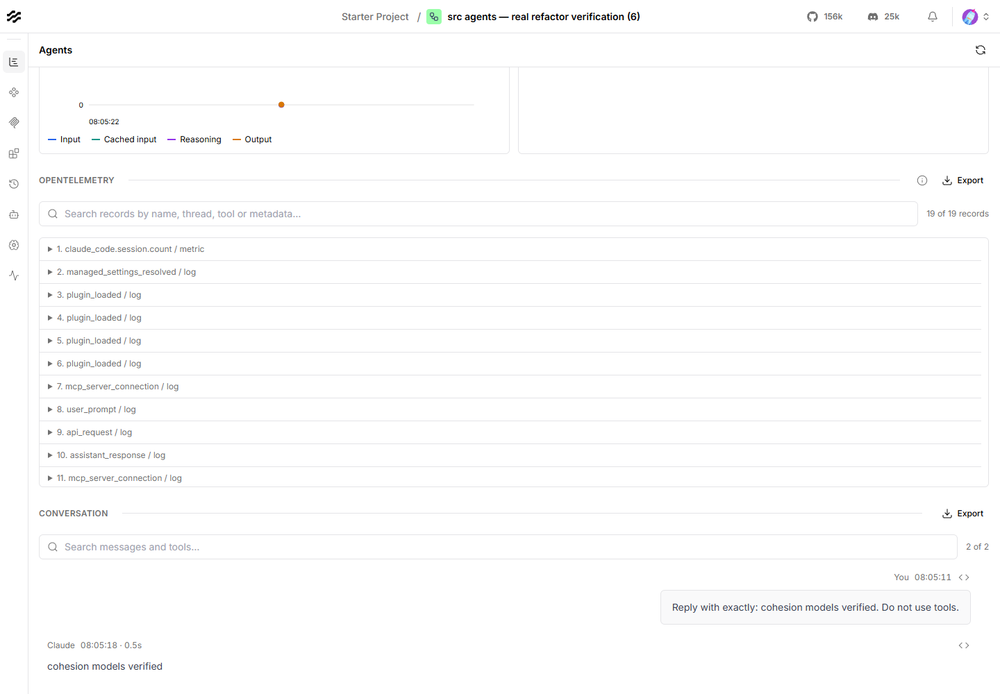

# Agent user stories

Acceptance criteria describe intended behavior and were not re-verified for this
documentation increment. Consult the linked guides and revision-specific evidence.

These stories describe the existing Agent experience. **Implemented** means the
control or behavior exists in code; a screenshot alone is not an end-to-end test.
Images are actual app captures, not mockups. See [visual provenance](assets/README.md).

## AG-01 — Configure work on the Agent node

As a workflow author, I want to provide a task and choose a supported model and
reasoning effort on the Agent node, so I can control how the work runs.

**Status: Implemented.** Task, Operation, Model and Reasoning Effort stay visible;
technical settings sit under Advanced controls. Optional skill references come
from the Skill node rather than duplicating Skill settings on the Agent.

Acceptance criteria:

- Model and effort choices come from the configured provider catalogue.
- Advanced controls can be collapsed without discarding their values.
- A fresh task can run without a skill; adding a Skill reference pins its revision.

*Actual app screenshot, 2026-10-28. This existing node is on Status, not Fresh;
capturing it did not execute a task or verify a new model call.*

Implementation: [Agent controls](../../../frontend/langflow-skill-viewer/README.md#agent-node-advanced-controls)
and [package ownership](architecture.md).

## AG-02 — Manage the same execution

As a workflow author, I want lifecycle operations to use the execution retained
by the Agent node, so I can inspect, continue or cancel work without creating a
separate prior-run node.

**Status: Implemented.** The Operation control in the screenshot above exposes
the provider-supported lifecycle. Fresh starts work; Status inspects the retained
run, and Resume or Cancel needs a valid prior execution reference.

Acceptance criteria:

- Status does not silently submit another task.
- Operations needing a prior run fail descriptively if no run is available.
- Cancel reports the actual known outcome; an uncertain remote result is not success.

Visual: [the actual Operation control above](assets/agent-node.png). This capture
shows Status only; it does not establish fresh Resume or Cancel acceptance.
Provider lifecycle guidance: [Claude example](../../../examples/claude-agent/README.md).

## AG-03 — Inspect what happened

As a workflow author, I want to open retained activity for the selected Agent,
so I can understand its result, messages, usage and execution context.

**Status: Implemented.** Activity opens the existing graph-wide Agents view;
viewing and refreshing do not dispatch another model request.

Acceptance criteria:

- The selected invocation retains its graph, node and run identity.
- Recorded conversation and available usage are visible; missing evidence stays explicit.
- A failed or incomplete trace is not presented as a successful execution.

*Actual app screenshot, 2026-10-28, showing the retained real run
`f61f8449-915b-4f1e-9d53-d9aa8b73c132`. No new model request was made for this capture.
The running app is the existing deployed review runtime, not proof that later
checkout changes have been deployed.*

Details: [Activity](activity.md), [local runner recovery](runner/local-service.md)
and [node boundaries](../../architecture/node-contracts.md).
