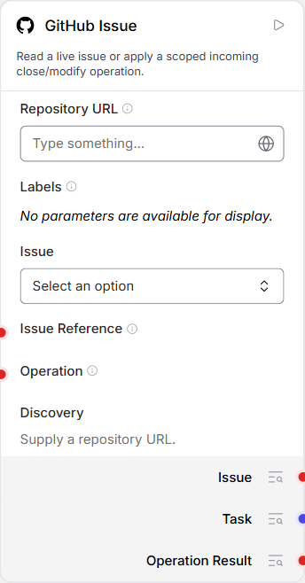
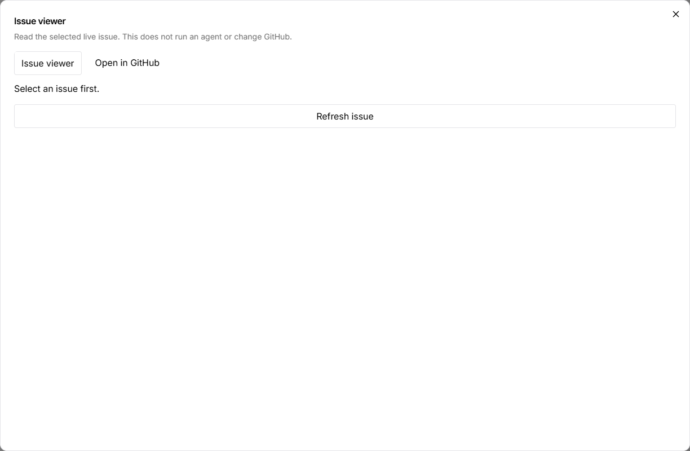

# Work from a GitHub issue

Use this when a task already lives in GitHub and you want the graph to preserve
its identity. You will select a real issue, inspect its current content and read
its outputs without invoking an Agent or changing GitHub.

## Before you start

Complete [the shared GitHub connection setup](../connection.md), starting the
Issue service for your chosen repository and configuring the app's Issue URL and
transport-token path. The first steps need read access only. Write authorization
is a separate prerequisite for the optional last section.

## 1. Select the issue

1. Create a blank flow named **Inspect repository work**.
2. Add **GitHub Issue** and set Repository URL to the exact repository configured
   on the host, for example `https://github.com/YOUR-OWNER/YOUR-REPOSITORY`.
3. Refresh discovery. Leave Labels empty to start; choose an issue explicitly.
4. To narrow the list, select labels. All selected labels must match. Refresh
   Issue after changing the filter, and verify the intended number and title.
5. For a closed issue, change State under the node's advanced settings to closed
   or all, then choose the issue again.



*Existing actual form, unconfigured. Your configured service should populate the
choices; this image does not demonstrate successful GitHub access.*

Expected result: the Issue picker identifies a specific issue in your repository.
Changing repositories clears dependent choices; a stale earlier issue must not
silently become the target in another repository.

## 2. Read it in the app and in GitHub

Select the node and open **Issue viewer**. Check its number, title, body, state
and labels. Use **Open in GitHub** to open that same issue's URL in a separate tab.
Opening the viewer does not submit an operation or a model task.



*Existing actual empty state. Select a real issue first; the picture is not a
populated provider view. [Visual provenance](assets/README.md).*

If nothing is selected, choose an issue on the node rather than guessing a
reference. If the viewer reports unavailable content, check the configured
repository and host service; do not treat the failure as an empty issue.

## 3. Read the node's outputs

Leave **Operation** unconnected and run the Issue node once to fetch its current
data. This read does not run an Agent. Inspect **Issue**, **Task**
and **Operation Result** in the node outputs.

Expected operation state: **not_requested**. The readable task message provides
issue context for an Agent if you later connect it. A failed or uncertain read
must not feed an apparently valid task downstream.

## Optional: apply an authorized update

Do this only with the [trusted host binding](../connection.md#before-you-enable-any-write)
already configured and permission to change this exact issue. Use a disposable
issue you own when learning the write path.

Connect the trusted operation source to **Operation**. For a title-only update,
the operation's content fields are:

```json
{"action": "modify", "changes": {"title": "Clarify the first-run setup"}}
```

This is **not the complete ordinary-operation envelope**: its trusted producer
must also supply the valid host-bound `grant_ref` and stable `request_id` required
by the Issue contract. Keep live capability values out of published examples and
saved exports. Do not ask the Agent to invent them. The current Issue node does
not offer the PR node's same-node Agent feedback cycle.

Run the owning Issue node once. Check Operation Result, then independently read
the issue in GitHub. Expect only the requested title to change; the operation
does not request a body or label replacement. A failure is not success, and an
unknown result needs reconciliation of its existing intent before another write.
For close or body/label changes, use the [Issue operation reference](../../../../examples/github-issue/README.md).

## Finish

Keep the selected flow and any operation result. If you enabled a grant, revoke
it after use. Stop the host service only after pending operations are resolved;
retain its private intent database. [Shared connection cleanup](../connection.md#finish).
