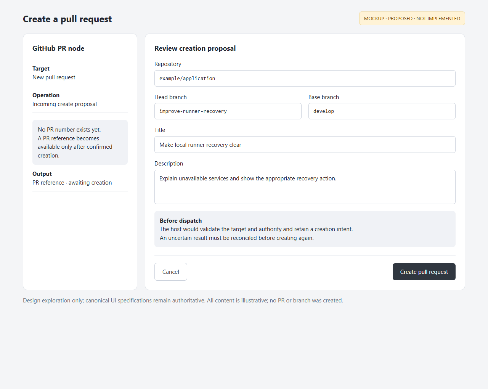

# Pull-request user stories

Acceptance criteria describe intended behavior and were not re-verified for this
documentation increment. Consult the linked guides and revision-specific evidence.
Actual screenshots are labelled separately from proposed mockups.
See [visual provenance](assets/README.md) and [shared architecture](../architecture.md).

## PR-01 — Select a pull request

As a workflow author, I want to choose a repository, filter by labels and select a
PR, so the workflow operates on an explicit piece of work.

**Status: Implemented.** Repository URL, Labels and PR belong to the PR node.

Acceptance criteria:

- Repository changes clear dependent selections; all selected labels must match.
- Refresh does not silently select the first result or replace an exact identity.
- A missing selection is distinct from a connection error or an empty result list.

*Actual component form, 2026-10-28. The documentation node is unconfigured;
no repository data or operation outcome is fabricated.*
Guide: [PR node](../../../../examples/github-pr/README.md).

## PR-02 — Inspect the selected PR without running it

As a workflow author, I want to view the selected PR in the app and open its exact
GitHub page, so I can check the context before running an operation.

**Status: Implemented; populated viewer not captured here.** PR viewer and
Open in GitHub use the valid picker selection. A runtime-only reference is not
guessed into a saved selection.

Acceptance criteria:

- Opening the viewer fetches scoped content without executing an operation or model call.
- Open in GitHub targets the exact selected repository and PR number.
- Loading, unavailable content and no selection remain distinguishable.

*Actual empty state, 2026-10-28. The existing read-only PR inspection connection
returned HTTP 400 during capture, so no populated modal is shown. No provider
content was invented.*
Guide: [PR inspection](../../../../frontend/langflow-skill-viewer/README.md#github-pr-alignment).

## PR-03 — Apply an Agent proposal through the PR node

As a workflow author, I want an Agent to return a scoped operation to the selected
PR node, so the host can validate and apply it to the intended PR.

**Status: Implemented for existing targets.** PR context goes to the existing
Agent, which returns its proposal to Operation on the same PR node.

Acceptance criteria:

- Existing-target operations require a selected or otherwise valid bound PR target.
- The host validates identity and authorization; an Agent cannot supply its own authority.
- Confirmed, failed and unknown outcomes remain distinct; uncertain writes are not blindly resent.

Visual: [the actual PR Operation input and Operation Result output](assets/pr-node.png).
Recorded real example: [original Agent PR feedback](../../../../examples/github-pr/original-agent/README.md)
and its [evidence](../../../../examples/github-pr/original-agent/evidence.json), dated
2026-10-15. No new GitHub write was made for these stories.

## PR-04 — Create a PR before its reference exists

As a workflow author, I want to request a new PR using a repository and branch pair,
so I can create work without first selecting a PR that does not yet exist.

**Status: Proposed; not implemented by the current PR node.** Its current Operation
contract supports modifying or closing existing PRs. The mockup explores a future
creation mode and must not be treated as a shipped control or approved contract.

Proposed acceptance criteria for discussion:

- Creation supplies repository, head/base branches, title and body instead of a PR number.
- The host validates authority and records a creation intent before dispatch.
- Only a confirmed creation emits the new PR reference and link; uncertain results
  require reconciliation before another create attempt.

*Mockup with illustrative branches and title. No PR was created.
This exploration does not replace canonical UI design specifications.
[Editable HTML mockup](assets/create-pr-mock.html).*
