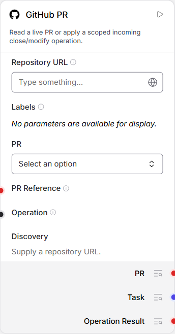
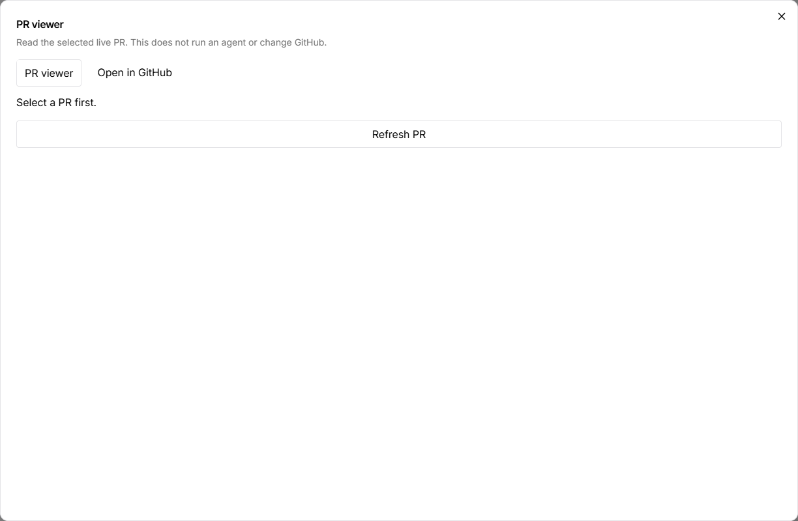

# Inspect a PR and apply an Agent proposal

Use this when you need an Agent to work from the current PR context while the
PR node retains the target and the host controls the write. Start with read-only
selection; the optional operation path needs an existing exact-target grant.

## Before you start

Complete [the shared GitHub connection setup](../connection.md) for the PR service.
Inspection needs no Agent. The optional proposal path also uses the configured
real Agent from [getting started](../../../getting-started.md) and a pinned Skill
that states the precise change. The steps below use the existing
`pr-feedback-title` skill imported in [the Skill walkthrough](../../skills/walkthrough.md).

## 1. Select and inspect a PR

1. Create a blank flow named **Inspect a pull request** and add **GitHub PR**.
2. Enter the exact repository URL configured on the host and refresh discovery.
3. Select the PR explicitly. Labels use all-match filtering; State controls whether open, closed, merged or all PRs are offered.
4. Open **PR viewer** to read the current title, description, labels, branch pair,
   state and draft/merged status. Use **Open in GitHub** to check that same PR.





*Existing actual unconfigured/empty states, not populated live reads. The earlier
capture's PR inspection connection was unavailable; these images do not replace
your own connection check. [Visual provenance](assets/README.md).*

Leave the **PR** input unconnected and run the node once. Its single **PR**
output contains the snapshot and an operation outcome of **not_requested**. Reading or opening a viewer does
not change GitHub or invoke a model.

## 2. Prepare one precise update

The next step changes a real PR. Use a disposable PR you own, and have a live
host binding for that exact target before adding feedback. A read-only connection
is not enough. The PR service needs both its existing scoped grant-binding map
and `--feedback-bindings` mapping the exact `repository#PR` to that reference;
neither belongs in the graph. If that host setup is absent, stop after inspection.

The unmodified **pr-feedback-title** skill requests the exact title
**Original Codex Agent feedback verified**, preserving the description and labels.
That title is fixed example text from the Skill, even when Claude makes the
proposal. Read it before using it. To request a different title, first create and review
a new Skill revision; editing the Agent Task in this feedback topology will not
replace the PR controller's seeded task.

## 3. Wire the existing Agent back to the same PR

Add the existing **Laomedo Claude Agent** and a read-only **Laomedo Skill** selecting
that exact `pr-feedback-title` revision. Leave the Skill's Edit Request and
Operation empty. Configure the Agent's runner URL, model and effort; use Fresh.

```text
GitHub PR.PR -------------> Claude Agent.Task
Claude Agent.Answer --------> same GitHub PR.PR
Pinned Skill.Skill Reference --> Claude Agent.Skill References
```

Use the single **PR** input for the return edge. This is the supported bounded
feedback connection, not an arbitrary cycle or a second PR node. The pinned
Skill is an independent read-only dependency. Do not add a manual PR operation
value alongside the feedback edge or wire unrelated inputs into its isolated body.

This walkthrough uses Claude. The maintained `examples/github/build_flow.py`
builder uses the existing Codex Agent with the same PR context feedback wiring.

## 4. Run once and confirm the actual result

Run the **GitHub PR** controller once. It reads current PR data, reserves its
host-owned feedback ticket, invokes the Agent for a content-only proposal, and
validates and applies the operation. Do not run the Agent separately first.

Expected successful result: the PR output operation status is **succeeded**, the selected PR's
title is **Original Codex Agent feedback verified**, and the body and labels are
unchanged. Open GitHub and read the PR independently before calling the update
complete. An Agent answer proposing JSON is not confirmation that GitHub changed.

The proposal format for this title-only example is:

```json
{"action": "modify", "changes": {"title": "Original Codex Agent feedback verified"}}
```

The Agent supplies no request identity, target, ticket or grant. The host binds
those separately. Changed PR content, expired authority or invalid proposals can
refuse the update. If the outcome is **unknown**, inspect the existing host intent
and remote PR before a new run; repeating Fresh can submit another model task
and another operation.

The [recorded original-Agent example](https://github.com/amadou-6e/laomedo/blob/714db418243bc17fff1c2a5bed5181006e21fdee/archives/github-244/files/examples/github-pr/original-agent/README.md)
demonstrated this title update using Codex in its named historical run. It is not
a new execution of this Claude walkthrough or proof of every model's proposal quality.

## Finish

Revoke any separately enabled grant after the intended operation. Preserve the
flow, run identity and host intent record; stop only the services you started
after outstanding outcomes are resolved. [Shared connection cleanup](../connection.md#finish).

Creating a PR without an existing reference remains
[a proposed workflow](user-stories.md#pr-04--create-a-pr-before-its-reference-exists),
not another option on the current node.

## Structured PR handoff

Maintained examples use the single PR input and output. Update Agent components
alongside PR components so their Task input accepts structured PR context. The
Agent formats a successful context and refuses failed/unknown outcomes before
runner dispatch. An earlier outcome is never replayed as an operation request.
