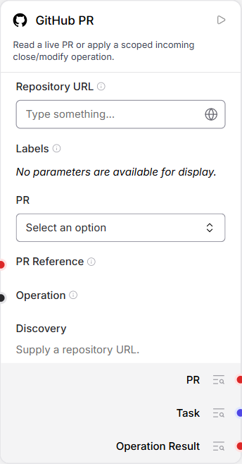
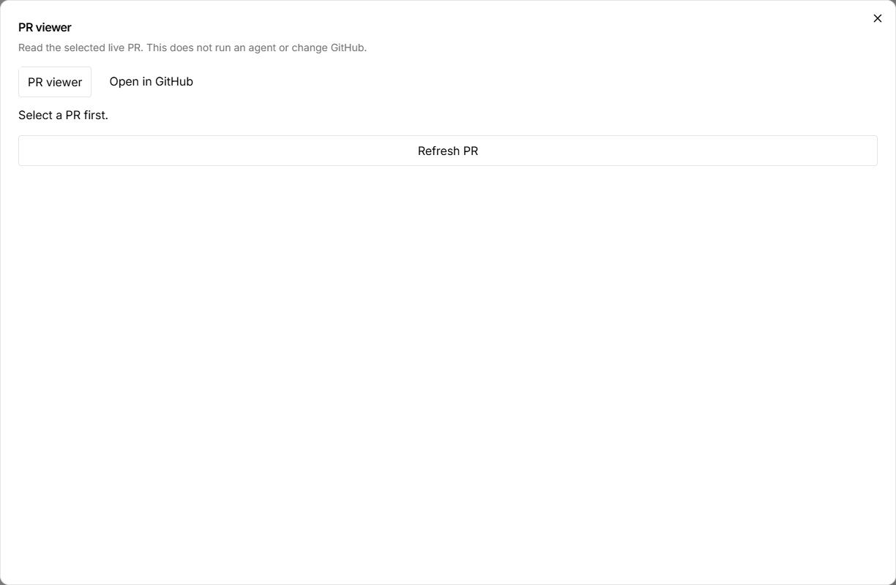
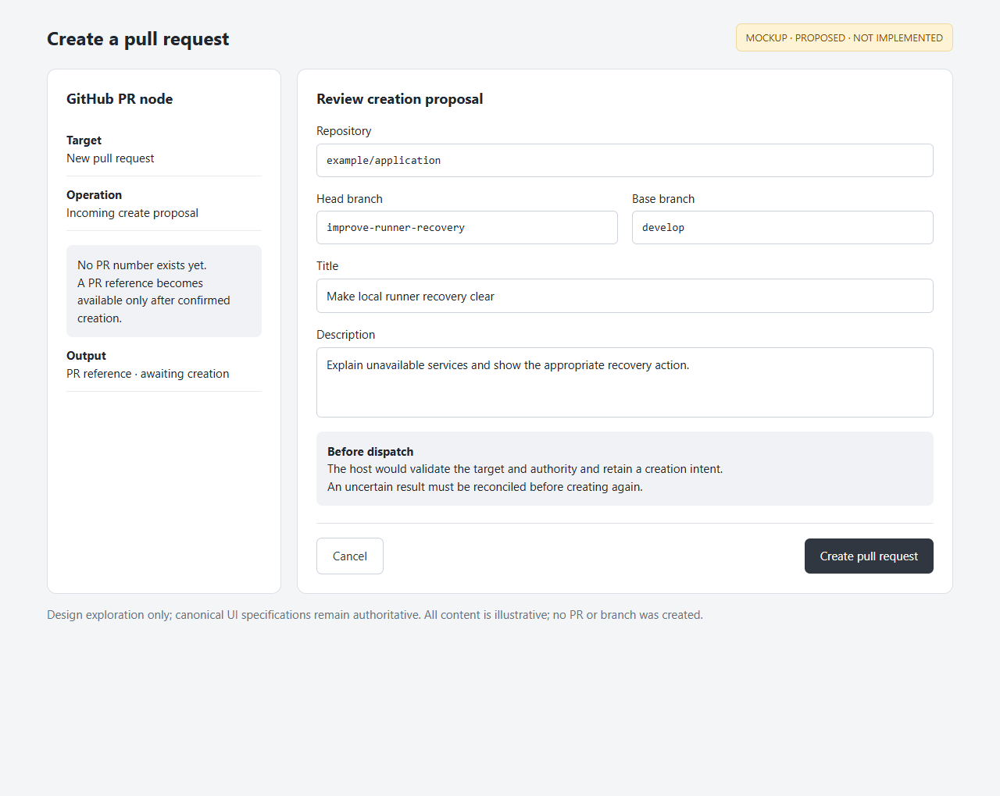

# GitHub user stories

Acceptance criteria describe intended behavior and were not re-verified for this
documentation increment. Consult the linked guides and revision-specific evidence.

Issue and PR nodes own repository selection and operations. The screenshots below
show actual implemented component forms. Their host connection is not configured
for this documentation graph; they do not demonstrate a successful GitHub read or
write. The deferred creation story uses a labelled mockup.
See [visual provenance](assets/README.md).

## GH-01 — Select an issue or pull request

As a workflow author, I want to choose a repository, filter by labels and select an
issue or PR, so the workflow operates on an explicit piece of work.

**Status: Implemented.** Issue and PR nodes use the same selection pattern.

Acceptance criteria:

- Repository changes clear dependent selections; all selected labels must match.
- Refresh does not silently select the first result or replace an exact identity.
- A missing selection is distinct from a connection error or an empty result list.

*Actual current component forms, 2026-10-28. Both are intentionally unconfigured;
no repository data or operation outcome is fabricated.*

Guides: [Issues](../../../examples/github-issue/README.md) and
[pull requests](../../../examples/github-pr/README.md).

## GH-02 — Inspect the selected work without running it

As a workflow author, I want to view the selected issue or PR in the app and open
its exact GitHub page, so I can check the context before running an operation.

**Status: Implemented; populated viewer not captured here.** The selected node's
toolbar provides Issue viewer/PR viewer and Open in GitHub. A valid picker selection
is required; a runtime-only reference is not guessed into a saved selection.

Acceptance criteria:

- Opening the viewer fetches scoped content without executing an operation or model call.
- Open in GitHub targets the exact selected repository and number.
- Loading, unavailable content and no selection remain distinguishable.

*Actual viewer empty states, 2026-10-28. The current PR inspection connection
returned HTTP 400 during read-only capture, so a populated modal could not be
captured. These images show the real selection requirement, not invented content.*
See [Issue inspection controls](../../../examples/github-issue/README.md#issue-inspection-controls)
and [PR inspection](../../../frontend/langflow-skill-viewer/README.md#github-pr-alignment).

## GH-03 — Apply an Agent proposal through the owning node

As a workflow author, I want an Agent to return a scoped operation to the selected
GitHub node, so the host can validate and apply it to the intended issue or PR.

**Status: Implemented for existing targets.** The PR workflow can feed PR context
to the existing Agent and return its proposal to Operation on the same PR node.
Issue operations also accept ordinary incoming operation data; this story does not
claim that Issue feedback has the same cycle support as PR feedback.

Acceptance criteria:

- Existing-target operations require a selected or otherwise valid bound target.
- The host validates identity and authorization; an Agent cannot supply its own authority.
- Confirmed, failed and unknown outcomes remain distinct; uncertain writes are not blindly resent.

Visual: [the actual PR Operation input and Operation Result output](assets/pr-node.png).
Recorded real example: [original Agent PR feedback](../../../examples/github-pr/original-agent/README.md)
and its [evidence](../../../examples/github-pr/original-agent/evidence.json), dated
2026-10-15. No new GitHub write was made for these stories.

## GH-04 — Create a PR before its reference exists

As a workflow author, I want to request a new PR using a repository and branch pair,
so I can create work without first selecting a PR that does not yet exist.

**Status: Proposed; not implemented by the current PR node.** Its current Operation
contract supports modifying or closing existing PRs. The mockup explores a future
creation mode and must not be treated as a shipped control or approved contract.

Proposed acceptance criteria for discussion:

- Creation supplies repository, head/base branches, title and body instead of a PR number.
- The host validates authority and records a creation intent before dispatch.
- Only a confirmed creation emits the new PR reference and link; uncertain results
  require reconciliation before another create attempt.

*Mockup with illustrative branches and title. No PR was created.
This exploration does not replace canonical UI design specifications.
[Editable HTML mockup](assets/create-pr-mock.html).*
