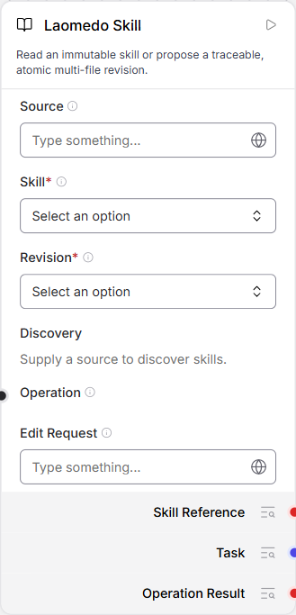
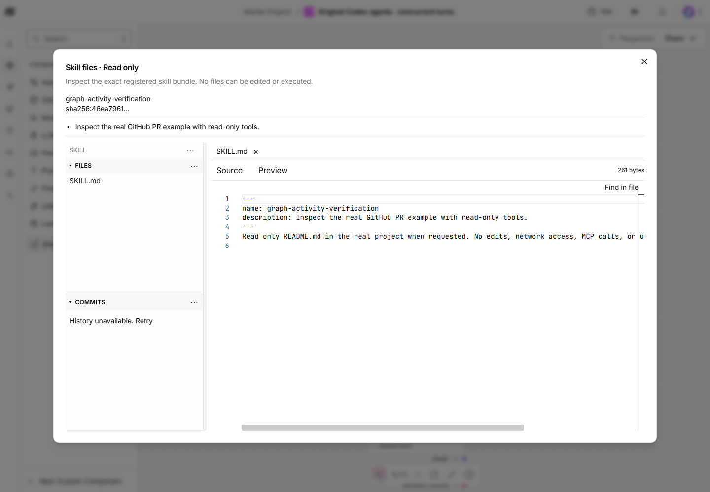
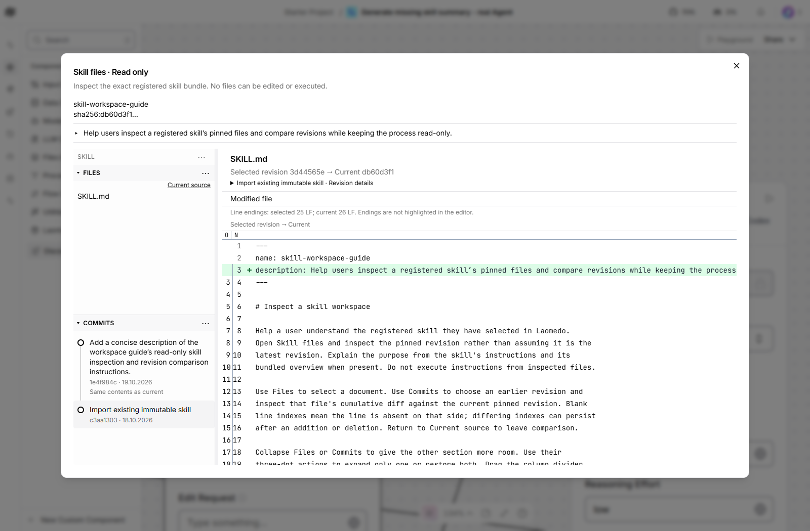
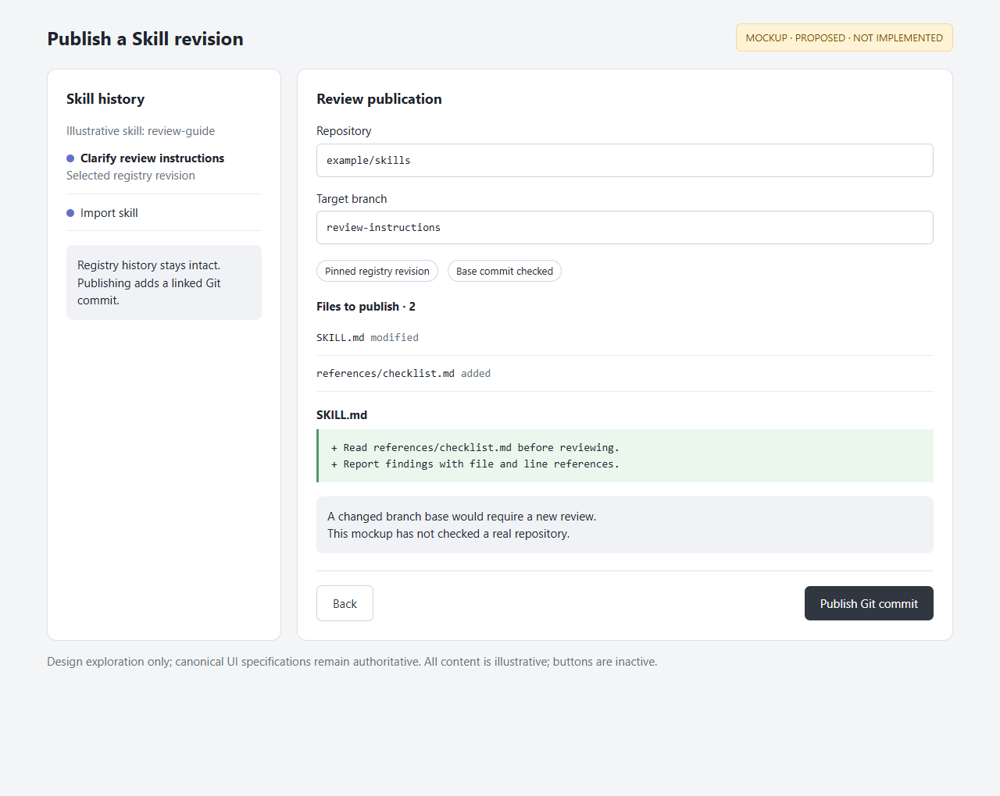

# Skill user stories

Acceptance criteria describe intended behavior and were not re-verified for this
documentation increment. Consult the linked guides and revision-specific evidence.

Implemented stories use actual app screenshots; the deferred Git publishing story
uses an explicitly labelled mockup. Status distinguishes implementation from live
acceptance. See [visual provenance](assets/README.md).

The [2026-11-02 navigation record](navigation-verification.md) adds current real
verification of the single SKILL menu, nested files and three-entry history;
the earlier captures below retain their explicitly dated scope.

## SK-01 — Select an exact skill revision

As a workflow author, I want to select a Skill and revision from a source,
so an Agent receives the intended instructions rather than an unspecified latest version.

**Status: Implemented.** Source and Skill are on the node; Revision is inside
the initially collapsed Advanced settings section. Source failures appear beneath
the input; no Discovery row appears. The empty Skill selector says No source found
until discovery supplies choices, then Select an option. Edit Request is not a node control.

Acceptance criteria:

- Changing Source clears dependent selections and ignores stale discovery responses.
- The Skill output carries the selected immutable identity.
- Inspecting a selection does not execute the skill or the graph.

*Historical component form, 2026-10-28, before the compact Advanced settings layout.
This documentation node has no source
or selected revision; the image illustrates the controls, not successful discovery.*

Guide: [source selection](../../../frontend/langflow-skill-viewer/README.md#linked-source-selector-157).

## SK-02 — Read the selected skill's files

As a workflow author, I want to browse the selected skill's files and preview its
instructions, so I can understand what I am giving the Agent.

**Status: Implemented; recovered inspection-error and refresh paths await final live validation.** Skill files opens the pinned immutable files. Where editing is authorized, changes remain in a working buffer until the user saves or publishes them.

Acceptance criteria:

- File navigation and Source/Preview refer to the selected revision.
- Browsing and resizing the split pane do not edit or execute the skill.
- Files and Commits can be navigated separately; unavailable history remains explicit.
+- Failed file, history and comparison reads show a shared plain-language explanation,
+  safe Technical details and a subtle copy control. Unknown read failures can reload
+  only the same selection; permanent unsafe, missing or oversized revisions offer
+  no futile reload. Reading or recovering these views never starts an Agent.
+- Printable editor keys do not activate canvas shortcuts or open Assistant. Find
+  uses the workspace search; native text selection and navigation remain available.
+- Background build-history refresh preserves the canvas, open Skill workspace and
+  unsaved buffers. A new flow's initial history read still gates its initial canvas,
+  including when previous-flow placeholder data is present.
+- Closing or changing a selection aborts its old client reads. Late success or
+  failure cannot overwrite the new selection or reopen dismissed content.
+

*Actual app screenshot, 2026-10-28, reading the existing registered
`graph-activity-verification` skill. Its file loads; its history service is unavailable
in this runtime, as shown. This is not a successful history demonstration.*

## SK-03 — Propose a traceable multi-file edit

As a skill author, I want one operation to change several files and retain its
parent revision and provenance, so I can review the complete change together.

**Status: Implemented.** An ordinary Operation input or feedback from the existing
Agent can produce a checked proposal. It does not automatically promote the canonical revision.

Acceptance criteria:

- All requested file additions, replacements and deletions are validated as one batch.
- The record retains parent commit, immutable file tree, changed paths and editor provenance.
- A rejected edit does not partially update the revision or silently promote it.

Visual: [the actual Skill Operation input](assets/skill-node.png) and
[an example single-file revision comparison](assets/skill-history.png).
Historical evidence: [real multi-file Agent edit](https://github.com/amadou-6e/laomedo/blob/1d3c2aa2d2e93222eac558091a5846c68fc33cec/archives/examples/skill-operations/evidence.json)
and [operation contract and limitations](https://github.com/amadou-6e/laomedo/blob/1d3c2aa2d2e93222eac558091a5846c68fc33cec/archives/examples/skill-operations/README.md).
Those records establish their named runs and revisions, not a fresh test of this checkout.

## SK-04 — Compare a file across revisions

As a skill author, I want to select a commit beneath the file tree and see the
selected file's cumulative diff to the current pinned revision, so I can understand
its evolution without reading a combined patch for every file.

**Status: Implemented.** The viewer has a commit tree, file-specific comparison,
Current source action and a draggable split pane.

Acceptance criteria:

- Selecting a commit keeps the file context and compares it with the current pinned state.
- Selecting another file shows that file's diff for the same comparison.
- Added and deleted lines are visualized without exposing raw `diff --git` commands.

*Historical actual screenshot, 2026-10-19, from the accepted
`skill-workspace-guide` viewer. The visible `1e4f984c` commit matches the real Agent
record in [Skill summary evidence](https://github.com/amadou-6e/laomedo/blob/ea577c0383a701a2a6bba2ed68bff3df41232f5d/examples/skill-summary/evidence.json).
It is not a new capture or a current-runtime history acceptance result.*

## SK-05 — Publish a reviewed registry revision to Git

As a skill author, I want to publish a reviewed registry revision as a Git commit,
so my source repository can retain the same reviewed file changes.

**Status: Proposed; not implemented.** Registry history comes first; Git publishing
is deferred. The following mockup explores a future review step, not an agreed API
or an existing control.

Proposed acceptance criteria for discussion:

- Preview the pinned revision, target repository/branch, base commit and exact file diff.
- Require explicit confirmation before publishing; reject a changed base instead of overwriting it.
- Link a confirmed Git commit back to the registry revision; keep uncertain outcomes explicit.

*Mockup with illustrative content. No publishing operation or Git integration was run.
This exploration does not replace canonical UI design specifications.
[Editable HTML mockup](assets/git-publishing-mock.html).*

## SK-06 - Edit and publish a multi-file revision

As a Skill author, I want existing text files to be editable immediately, with
Publish and Discard shown after an edit. Publish records the whole file batch in
one traceable commit and promotes it, retaining work on refusals and reconnect. Implemented;
[revision-specific real normal/recovery verification](manual-workspace.md) is
recorded separately from final owner acceptance.

## SK-07 - Inspect cumulative changes and publish explicitly

As a Skill author, I want the footer to disclose cumulative per-file changes
against registry current and let me inspect a selected diff before choosing
Publish, without a separate review mode. Publication refuses stale
heads/bases without changing graph pins or Git. Implemented; see the same
[real publication and replay record](manual-workspace.md). Git publishing in
SK-05 remains proposed. Final owner acceptance is pending.

## SK-08 - Manage working files

As a Skill author, I want to upload text and binary files, rename, move, delete
and copy relative paths from the explorer, so I can publish a complete traceable
revision without leaving the viewer. Implemented; see [actual workflows and
revision-specific evidence](manual-workspace.md).

Acceptance criteria:

- Right-click and keyboard menus provide the same target-specific actions.
- Picker/drop import is atomic; collisions, invalid paths and limits preserve work.
- Rename/move preserve bytes and buffers; Delete confirms; Discard restores saved files.
- Read-only and pending states block mutations while keeping inspection/copy available.
- Publish saves the complete batch and promotes the exact candidate; history retains
  changed paths, text differences and binary size/hash evidence.

Owner validation of the final workflow remains pending. Binary content editing,
directory uploads, empty folders and Git publication are outside this story.

### SK09 — Work with files using editor conventions

The owner retains empty working folders, renames directly in the filename row, deletes without a confirmation card and restores/reapplies Files actions with Ctrl+Z/Ctrl+Y. Drag targets have grey highlighting; Ctrl+X/V is the keyboard move path with no Move to menu. JSON has braces and binary files have inert raster or paged-byte previews. Publication keeps local empty folders but registry history remains file-only. Actual final evidence and constraints are in manual-workspace.md; owner validation is pending.

### SK10 — Preview and safely discard working files

The owner views binaries across the available editor pane without a byte/hash row, and returns from inline rename without a black filename outline. Discard opens a focus-trapped popup. Cancelling preserves exact buffers; confirming restores saved files/history. Dirty workspace dismissal shares this popup and closes only on explicit confirmation. Actual normal, full-page, small and Dark/Light evidence is in manual-workspace.md; owner validation remains pending.
