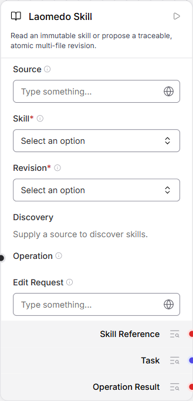
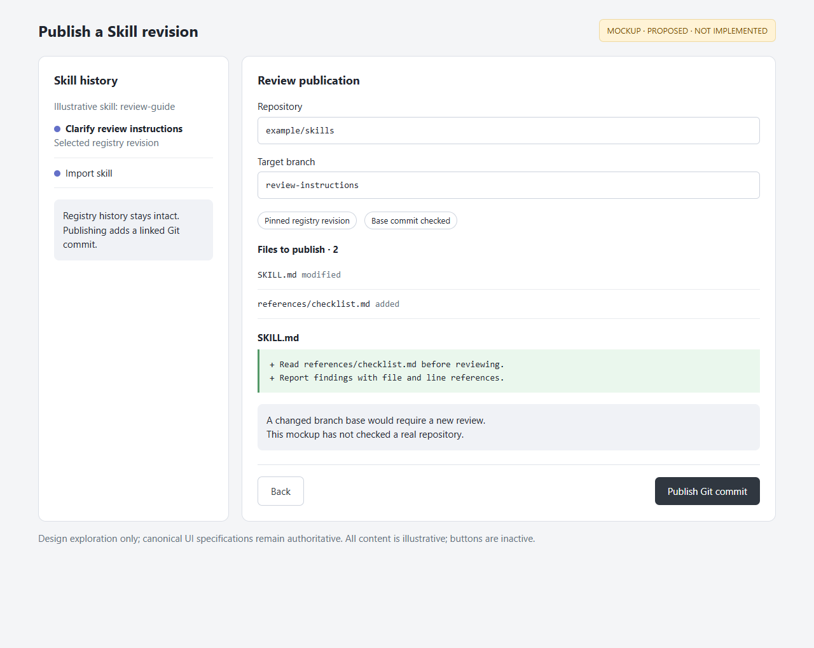

# Skill user stories

Acceptance criteria describe intended behavior and were not re-verified for this
documentation increment. Consult the linked guides and revision-specific evidence.

Implemented stories use actual app screenshots; the deferred Git publishing story
uses an explicitly labelled mockup. Status distinguishes implementation from live
acceptance. See [visual provenance](assets/README.md).

## SK-01 — Select an exact skill revision

As a workflow author, I want to select a Skill and revision from a source,
so an Agent receives the intended instructions rather than an unspecified latest version.

**Status: Implemented.** Source, Skill and Revision belong on the Skill node.

Acceptance criteria:

- Changing Source clears dependent selections and ignores stale discovery responses.
- The Skill output carries the selected immutable identity.
- Inspecting a selection does not execute the skill or the graph.
- Unconfirmed repository cleanup reaches the shared descriptive error presenter
  with `repository_cleanup_unverified` preserved. It does not advise refreshing
  discovery or removing retained staging while earlier Git processes may remain.

**Unverified failure path:** actual repository cleanup uncertainty has not been
safely reproduced through the node's discovery controls. Component/alert tests and
ordinary source-service outage are supporting or adjacent evidence; they do not
close this acceptance gap. Do not merge this path as verified on that basis.

*Actual current component form, 2026-10-28. This documentation node has no source
or selected revision; the image illustrates the controls, not successful discovery.*

Guide: [source selection](../../../frontend/langflow-skill-viewer/README.md#linked-source-selector-157).

## SK-02 — Read the selected skill's files

As a workflow author, I want to browse the selected skill's files and preview its
instructions, so I can understand what I am giving the Agent.

**Status: Implemented.** Skill files opens a read-only viewer of the pinned revision.

Acceptance criteria:

- File navigation and Source/Preview refer to the selected revision.
- Browsing and resizing the split pane do not edit or execute the skill.
- Files and Commits can be navigated separately; unavailable history remains explicit.
- Printable keys in the focused source editor do not activate canvas shortcuts,
  close the viewer or open Assistant. Selection, navigation and Find retain native
  editor handling; Escape closes Find before closing the viewer.
- Background build-history refresh preserves the mounted canvas, selected node
  and open viewer; reconnect leaves its read-only Reload control usable.
  A new flow's active history read still gates the initial canvas, including when
  the query temporarily supplies a previous-flow placeholder.
- Closing or changing selection retires old client results; a completed server
  read must not overwrite the new selection or reopen dismissed content.

**Recorded failure:** the actual Edge check at `67177b1` failed keyboard
isolation with Monaco's native EditContext DIV: typing in the read-only editor
closed the viewer and opened Assistant. Files and registry bytes were unchanged.
An editor-boundary correction requires focused review and fresh real-browser
evidence tied to its exact revision; the existing screenshots do not establish it.
Record that verification separately from these acceptance criteria.

*Actual app screenshot, 2026-10-28, reading the existing registered
`graph-activity-verification` skill. Its file loads; its history service is unavailable
in this runtime, as shown. This is not a successful history demonstration.*

## SK-03 — Propose a traceable multi-file edit

As a skill author, I want one operation to change several files and retain its
parent revision and provenance, so I can review the complete change together.

**Status: Implemented.** An ordinary Operation input or feedback from the existing
Agent can produce a checked proposal. It does not automatically promote the canonical revision.

Acceptance criteria:

- All requested file additions, replacements and deletions are validated as one batch.
- The record retains parent commit, immutable file tree, changed paths and editor provenance.
- A rejected edit does not partially update the revision or silently promote it.

Visual: [the actual Skill Operation input](assets/skill-node.png) and
[an example single-file revision comparison](assets/skill-history.png).
Historical evidence: [real multi-file Agent edit](../../../examples/skill-operations/evidence.json)
and [operation contract and limitations](../../../examples/skill-operations/README.md).
Those records establish their named runs and revisions, not a fresh test of this checkout.

## SK-04 — Compare a file across revisions

As a skill author, I want to select a commit beneath the file tree and see the
selected file's cumulative diff to the current pinned revision, so I can understand
its evolution without reading a combined patch for every file.

**Status: Implemented.** The viewer has a commit tree, file-specific comparison,
Current source action and a draggable split pane.

Acceptance criteria:

- Selecting a commit keeps the file context and compares it with the current pinned state.
- Selecting another file shows that file's diff for the same comparison.
- Added and deleted lines are visualized without exposing raw `diff --git` commands.

*Historical actual screenshot, 2026-10-19, from the accepted
`skill-workspace-guide` viewer. The visible `1e4f984c` commit matches the real Agent
record in [Skill summary evidence](../../../examples/skill-summary/evidence.json).
It is not a new capture or a current-runtime history acceptance result.*

## SK-05 — Publish a reviewed registry revision to Git

As a skill author, I want to publish a reviewed registry revision as a Git commit,
so my source repository can retain the same reviewed file changes.

**Status: Proposed; not implemented.** Registry history comes first; Git publishing
is deferred. The following mockup explores a future review step, not an agreed API
or an existing control.

Proposed acceptance criteria for discussion:

- Preview the pinned revision, target repository/branch, base commit and exact file diff.
- Require explicit confirmation before publishing; reject a changed base instead of overwriting it.
- Link a confirmed Git commit back to the registry revision; keep uncertain outcomes explicit.

*Mockup with illustrative content. No publishing operation or Git integration was run.
This exploration does not replace canonical UI design specifications.
[Editable HTML mockup](assets/git-publishing-mock.html).*
