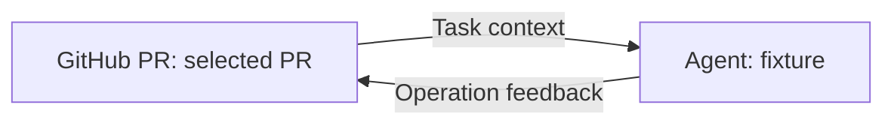

# GitHub PR node and operation graph

The intended workflow is **PR → existing Laomedo Codex Agent → the same PR**.
The PR-specific CLI agent, its builder and live export were removed at the user's
request. The original agent remains `components/laomedo/codex_agent.py` and uses
the existing Docker runner. The [original-Agent example](original-agent/README.md)
now records a real title update and native cancellation using that runner and a
host-stamped feedback operation. Its earlier blocked state is historical.

`operation-feedback-evidence.json` and `real-evidence.json` are historical checks
of earlier source revisions, including the removed CLI adapter. They do not
establish live acceptance of this head or the original Codex agent.
A grant reference authorizes use of its host-bound capability; treat it as
sensitive, not harmless metadata. Owner/flow binding is not yet implemented:
this connection is only suitable for a trusted single-user host. The old
short-lived campaign grant is not a reusable deployment configuration.
After applying the pinned viewer overlay, run
`python tools/apply_pr_operation_feedback.py PATH_TO_LANGFLOW` and rebuild its
frontend to enable manually drawing the bounded Operation feedback connection.
The normal input also accepts a Message containing the operation JSON.
The isolated body contains only the returning Agent; other upstream Agent inputs
are refused before dispatch. Only one PR feedback controller per graph is
supported. Graphs with multiple feedback controllers are refused.
The editor refuses existing external Agent inputs when closing the cycle; inputs
added afterwards are refused by the backend. The adaptation requires the pinned
Langflow revision. Feedback returns a content-only proposal; the trusted host
reserves and stamps request identity/grant reference. Configure exact feedback
scope before model dispatch; ordinary upstream envelopes remain compatible.
Reruns may incur another paid Agent turn before replay prevents duplicate writes.

The historical fixture files below are internal test material. They require
explicit user approval before being presented as a demo or deliverable.

The PR node uses the same repository/Labels/selection/Operation pattern as
GitHub Issue. Toolbar actions are PR viewer and Open in GitHub. Modify accepts
title/body/labels; close takes no changes. Operations use an opaque host grant,
durable request ID and matching PR reference. No credentials enter node fields.
The existing trusted Draft PR Publisher remains available for creation.

Generate the importable graph with `python examples/github-pr/build_flow.py`.
Run it without credentials or model calls using
`python examples/github-pr/run_fixture.py`. Both require lfx 1.12.3. The graph is:

For standalone lfx, set LANGFLOW_CONFIG_DIR and LANGFLOW_DATABASE_URL to a
disposable local directory/database before building or running. This avoids
using an existing Langflow application's settings or personal cache.

There are exactly two nodes. The PR reads first, executes the connected Agent
once in a native isolated loop body, applies its returned operation to that same
PR, and stops. Connect the Agent's operation output to the PR Operation input.
That same input accepts ordinary upstream operations when the source does not
receive this PR's Task. Conflicting sources or literal-plus-feedback values are
refused. Operation Result records
the terminal outcome. The fixture Agent is deterministic and makes no model call.
The component adapts the pinned runtime's eager parameter resolution only on its
own vertex, so the feedback socket cannot execute the Agent before the read.
The PR digest is checked again before writing to refuse concurrent edits.

The fixture runner injects a fake REST provider, uses real mediation and graph
ports, and runs twice to verify one mutation. Merely importing flow.json does
not configure a service; the fixture grant has meaning only inside that runner.
The earlier acyclic example is preserved in four-node-flow.json.

The reviewed feedback slice covers a selected PR and one Agent, optionally with
a downstream result inspector. Supplying PR Reference from an upstream source
inside a feedback graph is untested and unsupported; do not use that topology.

Durable replay prevents repeating a confirmed write only for an identical
operation payload and request identity. A fresh graph run still invokes its
Agent; a different returned payload with the same identity is refused as a
conflict. The internal deterministic replay test does not establish reuse of
a real model response without another model turn. Do not automatically retry.

For a separately approved deployment, copy github_pr.py into the installed
custom component category and apply/build the pinned frontend overlay. Set
LAOMEDO_GITHUB_PR_URL and LAOMEDO_GITHUB_PR_TOKEN_FILE on the Langflow backend.
Start the host with `python -m laomedo.github.pull_requests.cli --help`; its configuration
matches github_issue_server, with default port 8784. A transport token protects
the backend connection; a provider token and scoped grant bindings stay on the
host. Missing grants make writes unavailable. No ambient GitHub login is used.

Grant bindings resolve an opaque ref to token/run_id/repository. The mediator
grant must include pr_node_update, an exact target_prs number/base, and the
approved branch. Writes require a same-repository head. Forks remain readable.
Combined metadata/labels writes are not atomic: partial results remain unknown
and are never retried automatically. This example enables no live service.

New-PR proposal: expose Existing and Create draft modes on the same visible
node. Create draft accepts the validated run-bound publication handoff and
reuses the existing trusted publisher, with no PR picker required. Confirmed
creation emits PR Reference; downstream Existing nodes consume it. The run
viewer can inspect that returned reference. Unknown creation keeps the reference
absent until read-only reconciliation confirms it. This mode is a proposal.
