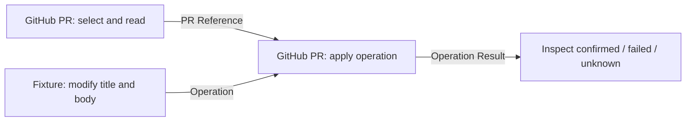

# GitHub PR node and operation graph

The PR node uses the same repository/Labels/selection/Operation pattern as
GitHub Issue. Toolbar actions are PR viewer and Open in GitHub. Modify accepts
title/body/labels; close takes no changes. Operations use an opaque host grant,
durable request ID and matching PR reference. No credentials enter node fields.
The existing trusted Draft PR Publisher remains available for creation.

Generate the importable graph with `python examples/github-pr/build_flow.py`.
Run it without credentials or model calls using
`python examples/github-pr/run_fixture.py`. Both require lfx 1.12.3. The graph is:

For standalone lfx, set LANGFLOW_CONFIG_DIR and LANGFLOW_DATABASE_URL to a
disposable local directory/database before building or running. This avoids
using an existing Langflow application's settings or personal cache.

The fixture runner injects a fake REST provider, uses real mediation and graph
ports, and runs twice to verify one mutation. Merely importing flow.json does
not configure a service; the fixture grant has meaning only inside that runner.

For a separately approved deployment, copy github_pr.py into the installed
custom component category and apply/build the pinned frontend overlay. Set
LAOMEDO_GITHUB_PR_URL and LAOMEDO_GITHUB_PR_TOKEN_FILE on the Langflow backend.
Start the host with `python -m laomedo.github_pr_server --help`; its configuration
matches github_issue_server, with default port 8784. A transport token protects
the backend connection; a provider token and scoped grant bindings stay on the
host. Missing grants make writes unavailable. No ambient GitHub login is used.

Grant bindings resolve an opaque ref to token/run_id/repository. The mediator
grant must include pr_node_update, an exact target_prs number/base, and the
approved branch. Writes require a same-repository head. Forks remain readable.
Combined metadata/labels writes are not atomic: partial results remain unknown
and are never retried automatically. This example enables no live service.

New-PR proposal: expose Existing and Create draft modes on the same visible
node. Create draft accepts the validated run-bound publication handoff and
reuses the existing trusted publisher, with no PR picker required. Confirmed
creation emits PR Reference; downstream Existing nodes consume it. The run
viewer can inspect that returned reference. Unknown creation keeps the reference
absent until read-only reconciliation confirms it. This mode is a proposal.
