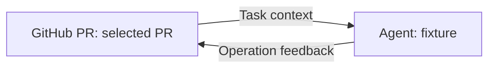

# GitHub PR node and operation graph

For a real Agent, `build_real_flow.py` exports the same two-node loop with
`components/laomedo/native_pr_agent.py`. It invokes the installed Codex CLI once,
using the existing host login and configured model, with read-only shell access.
The Agent returns a schema-constrained proposal; the PR node owns the write.
Set `LAOMEDO_CODEX_EXECUTABLE` and `LAOMEDO_PR_AGENT_WORKSPACE` on the app host.
Supply the actual repository, selected PR, requested change, stable request ID
and host grant reference to the builder. Credentials never enter graph fields.
The host must separately configure a live GitHub connection and scoped grant.
Without them the operation is refused; that refusal is not successful acceptance.

`real-flow.json` records the live example using disposable PR
[#20](https://github.com/ga84jog/laomedo-exp104-disposable-20261007/pull/20).
`operation-feedback-evidence.json` records the current Operation-input graph,
one native Codex turn, a confirmed description update, GitHub readback and
manual editor reconnection. `real-evidence.json` preserves the earlier infinity
socket demonstration as history.
The saved grant reference is an opaque campaign identity, not a credential;
the original short-lived grant is not a reusable deployment configuration.
The CLI adapter covers this local demonstration, not Docker runner isolation.
After applying the pinned viewer overlay, run
`python tools/apply_pr_operation_feedback.py PATH_TO_LANGFLOW` and rebuild its
frontend to enable manually drawing the bounded Operation feedback connection.
The normal input also accepts a Message containing the operation JSON.

The historical fixture files below are internal test material. They require
explicit user approval before being presented as a demo or deliverable.

The PR node uses the same repository/Labels/selection/Operation pattern as
GitHub Issue. Toolbar actions are PR viewer and Open in GitHub. Modify accepts
title/body/labels; close takes no changes. Operations use an opaque host grant,
durable request ID and matching PR reference. No credentials enter node fields.
The existing trusted Draft PR Publisher remains available for creation.

Generate the importable graph with `python examples/github-pr/build_flow.py`.
Run it without credentials or model calls using
`python examples/github-pr/run_fixture.py`. Both require lfx 1.12.3. The graph is:

For standalone lfx, set LANGFLOW_CONFIG_DIR and LANGFLOW_DATABASE_URL to a
disposable local directory/database before building or running. This avoids
using an existing Langflow application's settings or personal cache.

There are exactly two nodes. The PR reads first, executes the connected Agent
once in a native isolated loop body, applies its returned operation to that same
PR, and stops. Connect the Agent's operation output to the PR Operation input.
That same input accepts ordinary upstream operations when the source does not
receive this PR's Task. Conflicting sources or literal-plus-feedback values are
refused. Operation Result records
the terminal outcome. The fixture Agent is deterministic and makes no model call.
The component adapts the pinned runtime's eager parameter resolution only on its
own vertex, so the feedback socket cannot execute the Agent before the read.
The PR digest is checked again before writing to refuse concurrent edits.

The fixture runner injects a fake REST provider, uses real mediation and graph
ports, and runs twice to verify one mutation. Merely importing flow.json does
not configure a service; the fixture grant has meaning only inside that runner.
The earlier acyclic example is preserved in four-node-flow.json.

For a separately approved deployment, copy github_pr.py into the installed
custom component category and apply/build the pinned frontend overlay. Set
LAOMEDO_GITHUB_PR_URL and LAOMEDO_GITHUB_PR_TOKEN_FILE on the Langflow backend.
Start the host with `python -m laomedo.github_pr_server --help`; its configuration
matches github_issue_server, with default port 8784. A transport token protects
the backend connection; a provider token and scoped grant bindings stay on the
host. Missing grants make writes unavailable. No ambient GitHub login is used.

Grant bindings resolve an opaque ref to token/run_id/repository. The mediator
grant must include pr_node_update, an exact target_prs number/base, and the
approved branch. Writes require a same-repository head. Forks remain readable.
Combined metadata/labels writes are not atomic: partial results remain unknown
and are never retried automatically. This example enables no live service.

New-PR proposal: expose Existing and Create draft modes on the same visible
node. Create draft accepts the validated run-bound publication handoff and
reuses the existing trusted publisher, with no PR picker required. Confirmed
creation emits PR Reference; downstream Existing nodes consume it. The run
viewer can inspect that returned reference. Unknown creation keeps the reference
absent until read-only reconciliation confirms it. This mode is a proposal.
